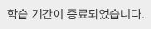
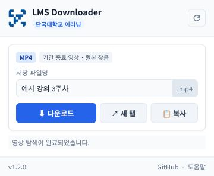
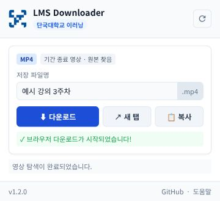

# 단국대학교 LMS Video Downloader

단국대학교 이러닝(LearningX / Canvas LMS / Uniplayer) 강의 동영상을 감지하고 다운로드하는 **Chrome 및 Chromium 계열 확장 프로그램**입니다.

[zinirun/LMSDownloader](https://github.com/zinirun/LMSDownloader)를 기반으로 수정한 비공식 도구입니다. 다른 대학은 시험하지 않았으며 지원 대상으로 안내하지 않습니다.

## v1.2.0

- 일반 영상 감지 및 다운로드, 저장 파일명 수정, 새 탭 재생, 영상 주소 복사
- 단국대 기간 종료 강의의 썸네일 단서를 자동 수집해 서버에 남아 있는 원본 탐색
- 개발자 도구나 콘텐츠 ID·주소를 직접 찾거나 입력할 필요 없음
- 업데이트 전에 열어둔 강의는 필요할 때 한 번 자동 새로고침

**원본 파일이 실제로 서버에서 삭제됐거나 서버가 조회를 거절하면 다운로드할 수 없습니다.** 기간이 끝나 화면에서 사라진 영상과 서버 원본 삭제는 다릅니다.

## 설치 방법

Chrome 111 이상 및 해당 기능을 지원하는 Edge·Whale·Brave 등 Chromium 계열에서 사용합니다.

1. [최신 릴리스](https://github.com/gopuda11/LMSDownloader/releases/latest)에서 `LMSDownloader-v1.2.0.zip`을 내려받고 폴더에 압축을 풉니다.
2. 브라우저의 확장 프로그램 관리 화면을 엽니다. Chrome은 `chrome://extensions/`, Edge는 `edge://extensions/`입니다.
3. **개발자 모드**를 켜고 **압축해제된 확장 프로그램 로드**를 누릅니다.
4. `manifest.json`이 있는 폴더를 선택합니다.
5. 확장 프로그램을 툴바에 고정하면 강의 화면에서 쉽게 열 수 있습니다.

기존 설치를 업데이트할 때는 새 파일로 덮어쓰고 확장 프로그램 관리 화면에서 **새로고침**을 누릅니다.

## 사용방법

### 1. 일반 영상

1. 단국대학교 LMS에 로그인하고 **개별 영상 강의 화면**을 엽니다.
2. 영상 재생 버튼을 누릅니다. 인트로가 있다면 본 영상이 나올 때까지 기다립니다.
3. 툴바의 **LMS Downloader**를 엽니다. 감지가 안 되면 **다시 스캔**을 누릅니다.
4. 파일명을 확인하고 **다운로드**를 누릅니다. 브라우저 기본 다운로드 폴더에 저장됩니다.

실제 LMS 플레이어의 재생 버튼만 캡처했습니다. 강의명·강의 내용·강좌 주소·학과·학년을 제외했습니다.


### 2. 기간 종료로 화면에서 내려간 영상

1. LMS에 로그인한 상태에서 기간이 종료된 **개별 강의 화면**을 엽니다.
2. **LMS Downloader**를 열면 강의 응답의 썸네일 단서로 원본을 자동 탐색합니다. 주소 복사나 개발자 도구 작업은 필요 없습니다.
3. **기간 종료 영상 · 원본 찾음**이 표시되면 파일명을 확인하고 **다운로드**를 누릅니다.
4. 자동 새로고침이 발생하면 팝업을 열어두고 탐색이 끝날 때까지 기다립니다.

실제 LMS의 기간 종료 안내 부분만 캡처했습니다. 강의명·강좌 주소·학과·학년·개인정보는 이미지에 포함하지 않았습니다.



아래는 실제 확장 프로그램 UI에 가상 강의 데이터를 넣어 촬영한 조작 예시입니다. 다운로드 완료 증빙 화면은 아닙니다.





## 데이터와 권한

자동 수집은 단국대 Canvas의 LearningX 강의 프레임에서 현재 강의 응답만 대상으로 합니다. 썸네일 주소·제목·항목 번호를 탭별로 브라우저 저장소에 임시 보관하고, 페이지 이동이나 탭 종료 시 지웁니다. 세션 저장소가 없는 환경에서는 로컬 저장소를 사용합니다.

이 기능은 로그인 비밀번호·쿠키·인증 헤더를 수집하거나 저장하지 않으며, 분석 서비스나 개발자 서버로 보내지 않습니다. 원본 탐색 요청은 단국대학교 콘텐츠 서버로 직접 보내며 인증정보를 제외합니다. 브라우저에서 영상과 원본 정보 요청이 발생합니다.

기존 영상 감지·다운로드 기능 때문에 모든 사이트 접근 권한을 요청합니다. 미디어 요청을 탭별로 감지하며 다운로드 요청에는 필요할 경우 해당 영상 서버에 Referer/Origin 헤더 규칙을 적용합니다. 사용하지 않을 때 확장 프로그램을 끄거나 브라우저 사이트 접근 설정을 제한할 수 있습니다.

## 검증 및 개발

```sh
node --test tests/*.test.cjs
python3 scripts/build.py
```

12개 자동 테스트로 Fetch/XHR 수집, 잘못된 발신자 거절, 작업 재시작 후 보관, 페이지 이동 시 정리, 기존 탭의 자동 새로고침, 원본 조회 및 오류 처리를 검증합니다. 테스트에는 가상 식별자만 사용합니다.

로컬 브라우저 통합 시험에서 실제 콘텐츠 서버의 메타데이터/XML 조회와 카드 생성·다운로드 요청 전달을 확인했습니다. Chrome API는 시험용 어댑터를 사용했으며, 설치된 확장 프로그램으로 로그인된 LMS 전체 동작을 검증한 것은 아닙니다. 실제 LMS 화면 캡처와 확장 프로그램 동작 검증은 별개입니다.

## 라이선스와 이용 범위

코드는 MIT 라이선스이며 원저작자 저작권 고지와 [LICENSE](LICENSE)를 유지합니다. 이 라이선스는 강의 영상의 이용·공유 권한을 부여하지 않습니다. 본인이 이용 권한을 가진 강의의 개인 학습 용도로 사용하고 학교의 이용 규정과 교수자의 안내를 확인하세요. 학교와 무관한 비공식 도구입니다.
