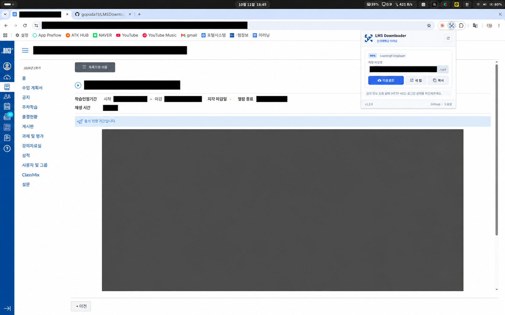
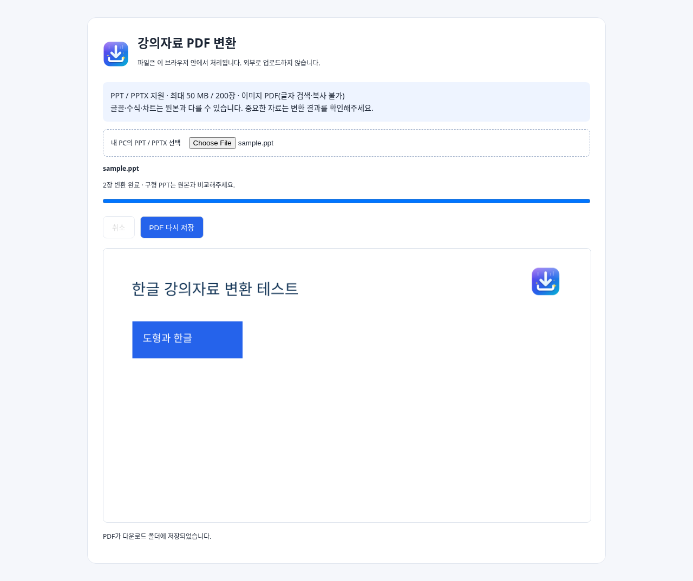

# 단국대 이러닝 강의 다운로더 (LMS Video Downloader)

단국대학교 이러닝(LearningX / Canvas LMS) 강의 영상을 감지해 다운로드하는 **크롬 확장 프로그램**입니다. Chrome·Edge·Whale·Brave 등 Chromium 계열에서 사용할 수 있으며 PPT/PPTX 자료의 PDF 변환 기능도 포함합니다.

[zinirun/LMSDownloader](https://github.com/zinirun/LMSDownloader)를 기반으로 수정한 비공식 도구입니다. 

**소개 페이지:** https://gopuda11.github.io/LMSDownloader/

## v1.3.1

- PPT/PPTX → PDF 변환 기능 포함 (실제 학교 강의자료 미확인)
- 정상 영상 감지 후 불필요한 LearningX 조회의 HTTP 401 안내가 남는 문제 수정
- 일반 영상 감지 및 다운로드, 저장 파일명 수정, 새 탭 재생, 영상 주소 복사
- 사이트 접근 권한을 단국대 서버와 확인된 영상 CDN으로 제한
- 다운로드 요청에 필요한 임시 규칙을 완료·실패 시 정리

## 설치 방법

Chrome 116 이상 및 해당 기능을 지원하는 Edge·Whale·Brave 등 Chromium 계열에서 사용합니다.

1. [최신 릴리스](https://github.com/gopuda11/LMSDownloader/releases/latest)에서 `LMSDownloader-v1.3.1.zip`을 내려받고 폴더에 압축을 풉니다.
2. 브라우저의 확장 프로그램 관리 화면을 엽니다. Chrome은 `chrome://extensions/`, Edge는 `edge://extensions/`입니다.
3. **개발자 모드**를 켜고 **압축해제된 확장 프로그램 로드**를 누릅니다.
4. `manifest.json`이 있는 폴더를 선택합니다.
5. 확장 프로그램을 툴바에 고정하면 강의 화면에서 쉽게 열 수 있습니다.

기존 설치를 업데이트할 때는 새 파일로 덮어쓰고 확장 프로그램 관리 화면에서 **새로고침**을 누릅니다.

## 사용방법

### 1. 일반 영상

1. 단국대학교 LMS에 로그인하고 **개별 영상 강의 화면**을 엽니다.
2. 영상 재생 버튼을 누릅니다. 인트로가 있다면 본 영상이 나올 때까지 기다립니다.
3. 툴바의 **LMS Downloader**를 엽니다. 감지가 안 되면 **다시 스캔**을 누릅니다.
4. 파일명을 확인하고 **다운로드**를 누릅니다. 브라우저 기본 다운로드 폴더에 저장됩니다.



### 2. PPT / PPTX 강의자료를 PDF로 저장 (실제 강의자료 미확인)

현재 수강 중인 과목에 PPT/PPTX 강의자료가 없어 **학교에 올라온 실제 자료로는 아직 확인하지 못했습니다.** 작동하지 않거나 변환 결과가 다르면 [GitHub Issues](https://github.com/gopuda11/LMSDownloader/issues)에 알려주세요. 확인하여 수정하겠습니다.

1. LMS의 **강의자료실 또는 주차학습**에서 PPT/PPTX 파일 링크가 보이는 화면을 엽니다. 필요하면 자료 상세 화면까지 열어주세요.
2. 확장 프로그램의 **강의자료 · PDF 변환** 목록에서 **PDF로 저장**을 누릅니다.
3. 새 변환 탭에서 진행 상황과 첫 슬라이드 미리보기를 확인합니다. 완료되면 PDF가 다운로드 폴더에 자동 저장됩니다.
4. 자료가 감지되지 않거나 학교 서버가 파일 조회를 거절하면 원본을 먼저 다운로드하고 **내 PPT / PPTX 파일 선택**으로 변환할 수 있습니다.

**별도 프로그램 설치, 계정 등록, 변환 서버 업로드가 필요 없습니다.** 기존 파일을 PPTX로 다시 저장하지 않아도 구형 PPT를 직접 읽습니다. 파일은 변환 탭 메모리에서 처리하며 변환 탭을 닫으면 사라집니다. 취소하면 진행 중인 변환을 중단할 수 있습니다.

- 최대 50 MB, 200장. 내부 압축 해제·이미지·출력 크기에도 제한이 있습니다.
- 슬라이드를 이미지로 담는 PDF이므로 **글자 검색·복사는 지원하지 않습니다.**
- 글꼴 대체, 구형 PPT의 일부 도형, 수식·차트·애니메이션은 원본과 다를 수 있습니다. 중요한 자료는 원본과 비교해주세요. 완전한 PowerPoint 호환을 보장하지 않습니다.
- 암호화·손상 파일은 지원하지 않습니다. PPTX의 외부 링크/리소스 및 매크로·OLE 삽입 콘텐츠는 차단합니다. 해당 파일은 원본 앱에서 PDF로 저장해주세요.
- 학교 도메인 밖에 있는 자료, 접힌 목록에 아직 표시되지 않은 링크, 별도 외부 도구의 버튼은 자동 감지되지 않을 수 있습니다. 로컬 파일 선택은 로그인 없이 사용할 수 있습니다.

아래는 개인정보가 없는 한글·도형·이미지 시험용 자료를 **실제 Chromium 확장 프로그램**으로 변환한 화면입니다.



## 데이터와 권한

영상 정보 수집은 단국대 Canvas의 LearningX 강의 프레임에서 현재 강의 응답만 대상으로 합니다. 썸네일 주소·제목·항목 번호를 탭별로 브라우저 저장소에 임시 보관하고, 페이지 이동이나 탭 종료 시 지웁니다. 세션 저장소가 없는 환경에서는 로컬 저장소를 사용합니다.

이 기능은 로그인 비밀번호·쿠키·인증 헤더를 수집하거나 저장하지 않으며, 분석 서비스나 개발자 서버로 보내지 않습니다. 영상 정보 요청은 단국대학교 콘텐츠 서버로 직접 보내며 인증정보를 제외합니다.

자료 변환은 표시된 단국대 자료 링크를 읽고, Canvas 파일·주차학습 API와 다운로드 주소에 브라우저의 로그인 세션으로 요청합니다. 쿠키 값을 읽거나 저장하지 않습니다. 렌더러는 확장 권한과 외부 네트워크가 차단된 격리 화면에서 실행됩니다. 변환 라이브러리는 패키지에 포함돼 있습니다. 파일·PDF·미리보기를 서버로 보내지 않습니다.

사이트 접근 권한은 `*.dankook.ac.kr`과 실제 확인된 영상 서버 `dankook-storage.commonscdn.com`으로 제한합니다. 미디어 요청을 탭별로 감지하며 다운로드에 필요한 임시 요청 규칙은 해당 영상 주소에만 적용하고 완료·실패·취소 시 제거합니다. 다른 학교나 확인되지 않은 외부 영상 서버는 지원하지 않습니다.

## 검증 및 개발

```sh
node --test tests/*.test.cjs
python3 scripts/build.py
```

PPT/PPTX 변환은 Chromium에서 시험용 자료로만 검사했습니다. 학교에 올라온 실제 강의자료와 모든 브라우저에서의 동작을 확인한 것은 아닙니다. 문제가 있으면 [GitHub Issues](https://github.com/gopuda11/LMSDownloader/issues)에 남겨주세요.

변환 코드를 수정할 때는 다음 순서로 번들과 패키지를 갱신합니다. 배포 ZIP만 사용하는 사용자는 이 작업이 필요 없습니다.

```sh
npm ci
npm run bundle
npm test
python3 scripts/build.py
# Python Playwright와 Chromium을 준비한 개발 환경에서:
python scripts/check-browser.py --output /tmp/lms-pdf-check
```

## 라이선스와 이용 범위

직접 작성한 코드는 MIT 라이선스이며 원저작자 저작권 고지와 [LICENSE](LICENSE)를 유지합니다. 이 라이선스는 강의 영상의 이용·공유 권한을 부여하지 않습니다. 본인이 이용 권한을 가진 강의의 개인 학습 용도로 사용하고 학교의 이용 규정과 교수자의 안내를 확인하세요. 학교와 무관한 비공식 도구입니다.

포함된 변환 라이브러리의 별도 라이선스는 [THIRD_PARTY_NOTICES.md](THIRD_PARTY_NOTICES.md)와 `vendor/licenses/`에 있습니다. PPTX 렌더러는 Apache-2.0, 구형 PPT 렌더러는 MIT이며 MPL-2.0 구성 요소의 소스 위치도 고지했습니다.
